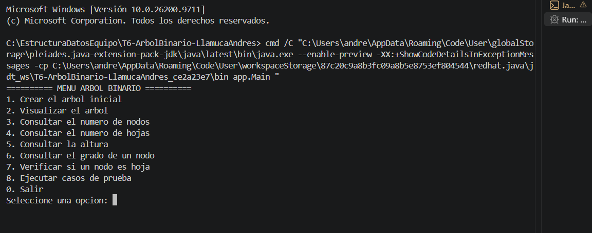
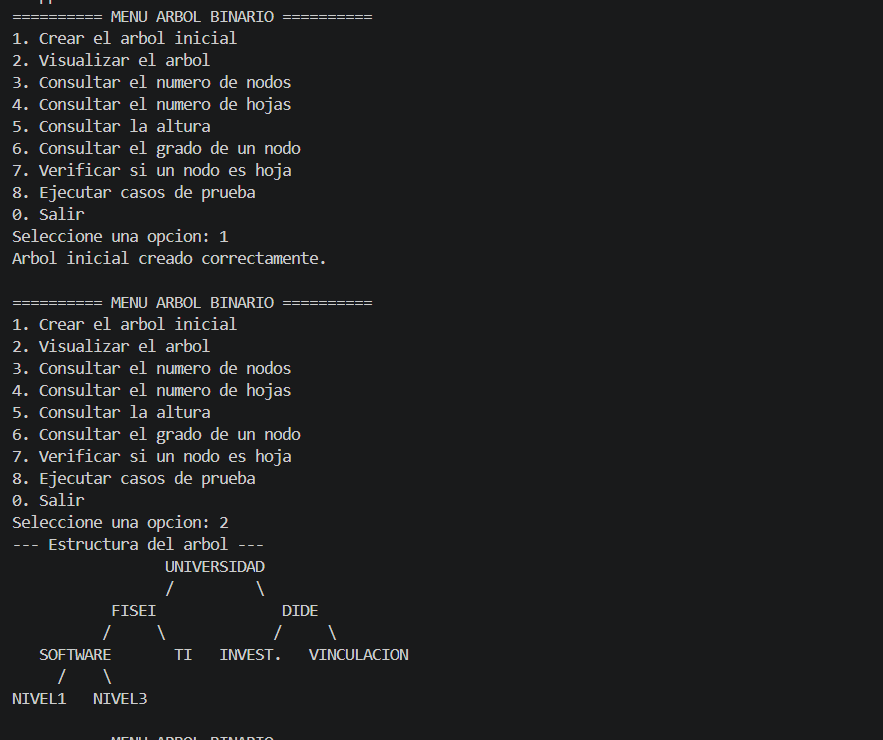
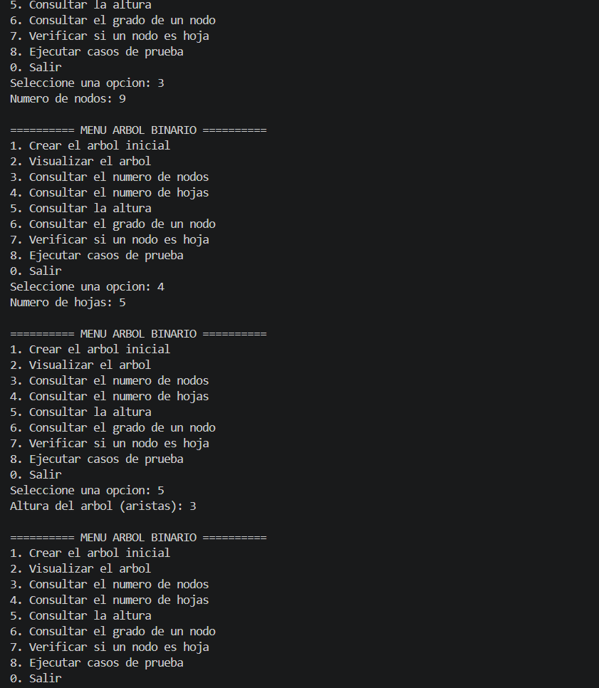
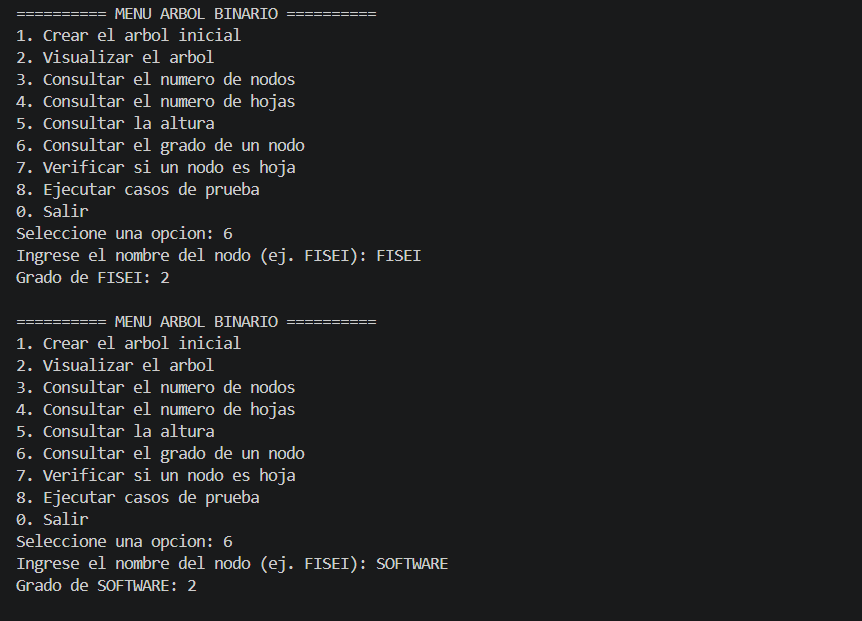
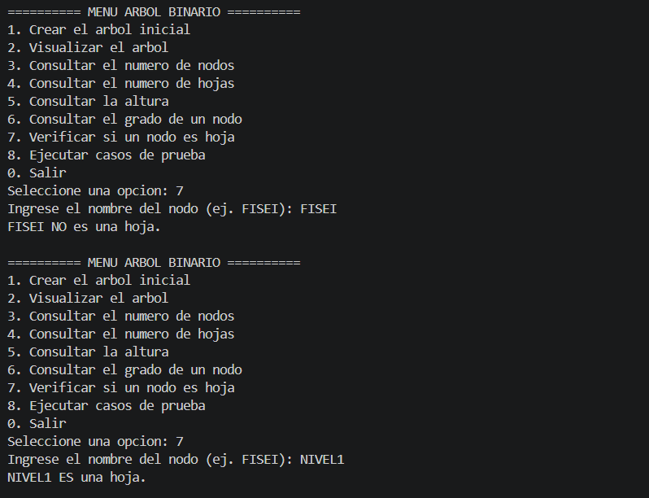
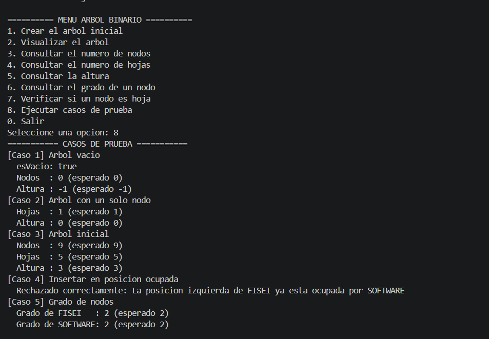

# T6 - Implementación de un Árbol Binario

**Autor:** Andrés Llamuca  
**Asignatura:** Estructura de Datos (Tercer Nivel - Ingeniería de Software)  
**Facultad:** FISEI - Universidad Técnica de Ambato  

## 1. Descripción del Problema

Este proyecto implementa un sistema orientado a objetos en Java para representar la organización jerárquica de las dependencias académicas de la Universidad. Se utiliza una estructura de datos de árbol binario donde cada nodo almacena el nombre de una dependencia y cuenta con un máximo de dos hijos. El sistema permite construir el árbol, visualizarlo por consola y analizar su estructura (cálculo recursivo de nodos, hojas y altura) mediante un menú interactivo.

## 2. Estructura del Árbol Binario

El sistema inicializa la siguiente jerarquía institucional, la cual contiene **9 nodos**, **5 hojas** y una **altura de 3 aristas**:

```
              UNIVERSIDAD
              /         \
        FISEI             DIDE
        /   \             /   \
  SOFTWARE   TI     INVEST.  VINCULACIÓN
    /   \
 NIVEL1 NIVEL3
```

## 3. Organización del Proyecto

```
T6-ArbolBinario-LlamucaAndres/
 ├── README.md
 ├── capturas/                    # Capturas de la ejecución
 └── src/
     ├── modelo/
     │   └── Nodo.java            # Nodo genérico Nodo<T>: dato, hijos, esHoja(), grado()
     ├── negocio/
     │   └── ArbolBinario.java    # Lógica del árbol: inserción, conteo, altura, visualización
     └── app/
         └── Main.java            # Menú interactivo con Scanner y casos de prueba
```

| Clase | Paquete | Responsabilidad |
|-------|---------|-----------------|
| `Nodo<T>` | `modelo` | Nodo genérico con dato, hijo izquierdo y derecho. Incluye `esHoja()`, `grado()` y getters/setters. |
| `ArbolBinario<T>` | `negocio` | `crearRaiz`, `agregarIzquierdo`, `agregarDerecho`, `contarNodos`, `contarHojas`, `altura`, `esVacio` y `mostrarArbol`. |
| `Main` | `app` | Menú interactivo con `Scanner`, construcción del árbol inicial y casos de prueba. |

### Lógica recursiva

- **Nodos:** si el nodo es nulo devuelve 0; si no, `1 + nodos(izquierdo) + nodos(derecho)`.
- **Hojas:** si el nodo es nulo devuelve 0; si no tiene hijos devuelve 1; si no, suma las hojas de ambos subárboles.
- **Altura:** si el nodo es nulo devuelve -1; si no, `1 + max(altura(izquierdo), altura(derecho))`. Así un árbol vacío tiene altura -1 y un solo nodo, altura 0.

### Restricciones cumplidas

- No se usan `TreeSet`, `TreeMap`, `PriorityQueue`, `NavigableSet` ni `NavigableMap`.
- El conteo de nodos, el conteo de hojas y la altura se implementan con recursividad.

## 4. Instrucciones de Ejecución

El proyecto puede ejecutarse desde cualquier IDE (como Visual Studio Code) o desde la terminal.

1. Clona este repositorio:
   ```bash
   git clone https://github.com/llamucaandres161-prog/T6-ArbolBinario-LlamucaAndres.git
   ```
2. Entra a la carpeta `src`:
   ```bash
   cd T6-ArbolBinario-LlamucaAndres/src
   ```
3. Compila:
   ```bash
   javac app/Main.java modelo/Nodo.java negocio/ArbolBinario.java
   ```
4. Ejecuta:
   ```bash
   java app.Main
   ```

> **Requisito:** JDK 8 o superior.

## 5. Menú del Programa

| Opción | Acción |
|--------|--------|
| 1 | Crear el árbol inicial |
| 2 | Visualizar el árbol |
| 3 | Consultar el número de nodos |
| 4 | Consultar el número de hojas |
| 5 | Consultar la altura |
| 6 | Consultar el grado de un nodo |
| 7 | Verificar si un nodo es hoja |
| 8 | Ejecutar casos de prueba |
| 0 | Salir |

## 6. Resultados

### 6.1 Menú principal



### 6.2 Creación y visualización del árbol (opciones 1 y 2)



### 6.3 Número de nodos, hojas y altura (opciones 3, 4 y 5)

El árbol inicial tiene **9 nodos**, **5 hojas** y una **altura de 3**.



### 6.4 Grado de un nodo (opción 6)

FISEI y SOFTWARE tienen grado 2.



### 6.5 Verificación de nodo hoja (opción 7)

FISEI no es hoja; NIVEL1 sí lo es.



## 7. Casos de Prueba

| Caso | Prueba | Esperado | Obtenido |
|------|--------|----------|----------|
| 1 | Árbol vacío | 0 nodos, altura -1 | 0 nodos, altura -1 |
| 2 | Árbol con un solo nodo | 1 hoja, altura 0 | 1 hoja, altura 0 |
| 3 | Árbol inicial | 9 nodos, 5 hojas, altura 3 | 9 nodos, 5 hojas, altura 3 |
| 4 | Insertar en posición ocupada | Se rechaza la inserción | Rechazado: la posición izquierda de FISEI ya está ocupada por SOFTWARE |
| 5 | Grado de FISEI y SOFTWARE | 2 y 2 | 2 y 2 |


